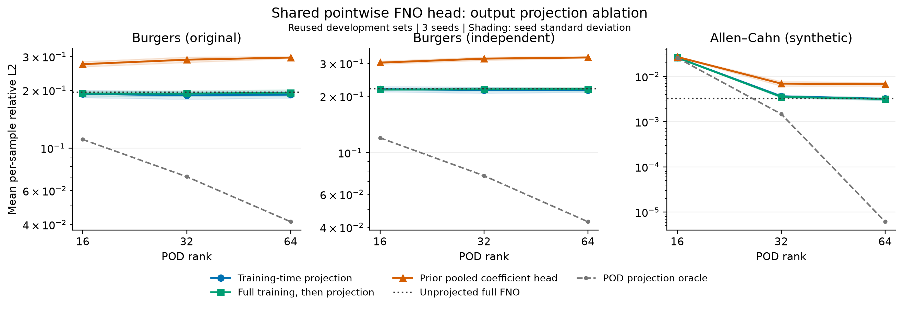

# Shared pointwise FNO head with training-time POD projection

Protocol seal3cac70a. 36 paired development fits: full output and training-time POD16/32/64 on three tasks, three seeds. The same FNO encoder and shared32→32→1 pointwise head has136481 real parameters in all arms. Initial states, minibatch sequences, optimizer and schedules are paired. Projection changes gradients and the output constraint together. Coefficient loss equals projected-field squared loss up to the fixed target projection error. Basis and400/600/200 representation/correction/development split match prior experiments. No new confirmation is opened or candidate selected for confirmation.

## Original Burgers completed

| Rank | Training-time projection dev | Full-training post-hoc projection dev | Prior pooled coefficient head dev |
|---|---:|---:|---:|
| 16 | 0.191759 | 0.192454 | 0.273799 |
| 32 | 0.188328 | 0.192368 | 0.288870 |
| 64 | 0.190009 | 0.194286 | 0.296425 |

Full-field dev0.195846 is reproduced bitwise by all three new full-arm checkpoints. The same pointwise model can learn projected coefficients without the prior large pooled-head gap. Rank32/64 training projection improves the paired post-hoc projection in each seed here; rank16 has mixed seed differences. These are development observations, without unseen-data inference. Previous pooled models differ in head structure, parameter count and initialization ordering, so their comparison supports investigating readout structure but does not uniquely establish head geometry as the cause.

## Independent Burgers completed

| Rank | Training-time projection dev | Full-training post-hoc projection dev | Prior pooled coefficient head dev |
|---|---:|---:|---:|
| 16 | 0.218613 | 0.217435 | 0.302838 |
| 32 | 0.216032 | 0.218254 | 0.318006 |
| 64 | 0.215583 | 0.218886 | 0.322749 |

Full-field0.220706 is reproduced bitwise. Rank16 training projection worsens the mean post-hoc comparison;32 has mixed seed signs;64 improves in all three seeds here. Therefore projection during training is not a uniformly better rule even within Burgers. The large pooled-head deficit is not imposed by the POD output constraint alone, but prior-model initialization and parameter differences prevent a uniquely causal head claim.

## Allen-Cahn completed

| Rank | Training-time projection dev | Full-training post-hoc projection dev | Prior pooled coefficient head dev |
|---|---:|---:|---:|
| 16 | 0.026170 | 0.026098 | 0.027097 |
| 32 | 0.003653 | 0.003552 | 0.006965 |
| 64 | 0.003207 | 0.003182 | 0.006762 |

Full-field0.003315 ±0.000286 is reproduced bitwise. Training-time projection is slightly worse than full training followed by projection at every rank and in every paired seed. POD64 training is better than unprojected full output by3.25% in the development mean, but post-hoc POD64 is better still; thus that comparison does not demonstrate a benefit from changing the training objective. The output projection itself removes out-of-subspace prediction components, with almost negligible true rank64 projection error here.

## Interpretation and next step

With the shared pointwise FNO head, projected outputs approach the full-field baseline and substantially outperform previous high-rank pooled coefficient heads. A fixed POD output space alone cannot explain the old deficit. Prior pooled-head comparisons still change parameter count, initialization ordering and readout architecture together; they do not prove that pooling is the unique cause. The paired current experiment isolates the effect of training projection within one architecture, including its changed gradients/objective.

Training-time projection has small, task/rank-dependent development gains in Burgers and no extra gain over post-hoc projection in Allen-Cahn. All current models retain136481 trainable real parameters and need projection at deployment; no parameter-efficiency or latency gain is established. No new architecture novelty is established by this ablation.

The next useful action is to lock the full, post-hoc-projection and training-projection controls and evaluate genuinely unused data. Keep post-hoc projection as a strong baseline. Any rank rule must be sealed before confirmation extraction, and every previously consumed set remains consumed. Independent confirmation is proposed here and has not been opened in this round.

Figure: reused development sets, three seeds; shading is seed standard deviation, not a confidence interval. The prior pooled head is a contextual model with different parameter count. POD oracle uses true coefficients and is not deployable. The logarithmic axis shows the large change in Allen-Cahn projection limits.

All36 final checkpoints and predictions were replayed, with orthogonal projection closure, same136481 parameter counts, exact initial-state fingerprints and independently regenerated minibatch hashes. All9 full-arm checkpoints reproduce historical final tensors bitwise. Re-running the driver skips all36 completed fits;57 regression tests passed. All intermediate/final metrics include raw and all three projected outputs. For POD-trained models the projected field is deployed; the unconstrained complement of the raw field is diagnostic.

Full numeric source: results/public_fno_projection_v1; protocol: docs/FNO_PROJECTION_V1.md; tables: docs/FNO_PROJECTION_V1_RESULTS.md. No new confirmation data were opened.
