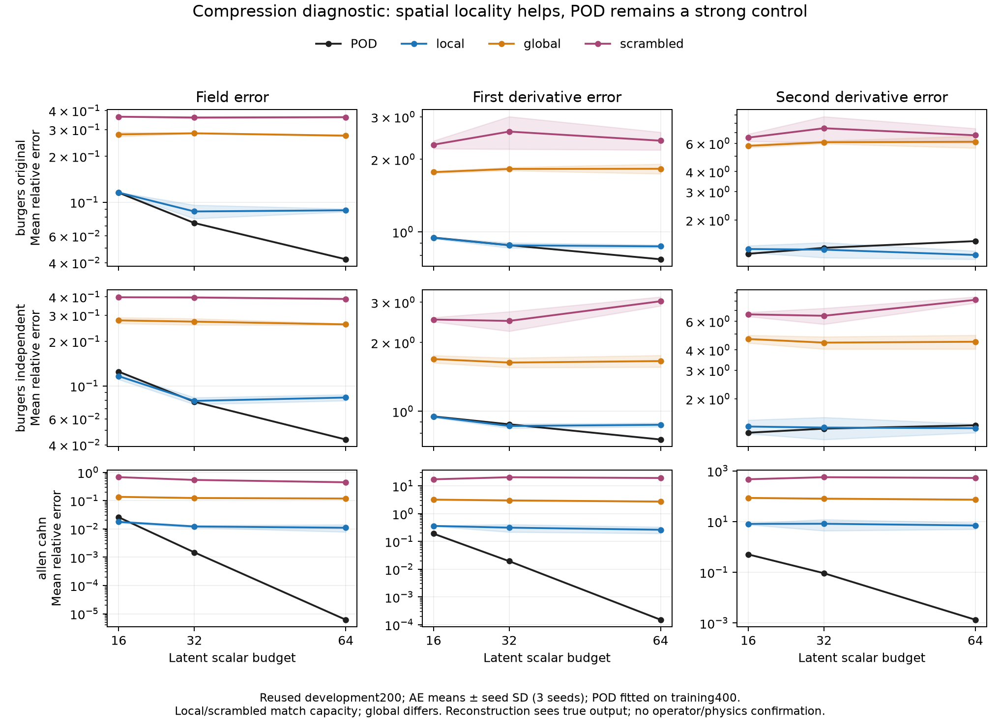
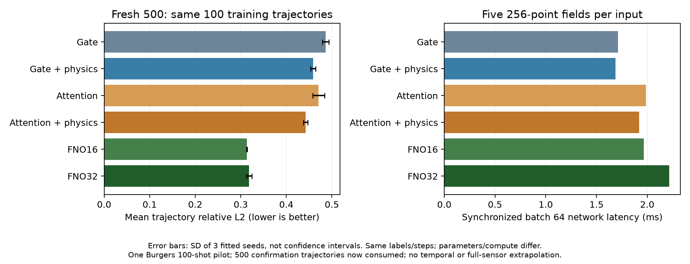

# Spatial latent tokens: staged hypothesis and development diagnostics

## 2026-10-10: midpoint and interval consistency complete

36 fixed models/360 windows on32 same development cases with NEW intermediate
snapshots (never fitting labels). Audit2160 independent Simpson checks, source/
reference/model/alternateAD/energy/summary identities pass; no module/loss/train.
Allen periodic/none intervalincrement.192823, reliable references. Fixed local
low-mode integral endpoint repair averages5.204% field benefit across3 seeds,
but earliest center.025 worsens. Burgers averages21.272% field degradation.
Both strict all-window screens FAIL22/24; do not retune to pass or delete early
windows. Potential next Allen jointinterval study is exploratory judgment, not
screen-qualified proof. Train-internal reliability-weighted continuous constraints
need uniform-integral/curvature controls and unused confirmation; integral/midpoint
physics are existing ideas, not enough for novelty. Full evidence/priorart:
../docs/INTERVAL_DIAGNOSIS_V1_RESULTS.md. New diagnostic times remain development.

## 2026-10-10: frozen temporal follow-up

All36 models checked on existing32 dev cases/four supervised future times, using
hashed original references, no new fit/data access. Allen periodic/none native-
resolved ut error.289333 and late.5 .716034 despite seam artifact removal.
Time energy.200847 vs state-RHS.573608 in a COMMON normalization; time dominance
only1/3 seeds, so registered3-seed screen fails. Oracle replacements reduce Allen
residual but are not corrected models or field-causal allocations. Burgers has
negative cross/cancellation and uncertain temporal FD reference. No temporal
constraint adopted: first register midpoint/short-interval development diagnosis.
Full table/precision repairs: ../docs/TEMPORAL_AFTER_PERIODIC_V2_RESULTS.md.

## 2026-10-10: completed paired periodicity and curvature-band controls

Same FNO layers34209 parameters, two coordinate encodings x three smoothing arms
x three seeds x two PDEs:48 fits including warm starts. Audit48 replayed results
and18 exact historical controls pass;83 tests pass. Allen periodic/data-only
field.037159 vs linear/data-only.043007 and curvature.336740 vs3.694110;
boundary curvature-error concentration2.57% vs98.25%. One field seed worsens,
and added curvature smoothing harms periodic-model field accuracy. Burgers
linear/low remains best mean field. No independent confirmation/new module.
Single periodic sine is non-injective, not a hard smooth-periodicity guarantee;
the intervention changes position information and cannot isolate a unique cause.
Next inspect remaining learned time derivatives before proposing new modules.
Full tables/cost caveats: ../docs/PERIODIC_CURVATURE_V1_RESULTS.md.

This is a new exploratory line, not a demonstrated method contribution. Full
protocol: docs/MANIFOLD_OPERATOR_ROADMAP_V1.md. All old confirmation sets remain
consumed. Reconstruction and fixed-time operator results must not be conflated.

## Stage1: compression quality

81 neural fits compare global MLP, physically ordered periodic CNN, and identically
parameterized CNN with a fixed spatial permutation; POD fitted to the same400
training output snapshots is retained. Scalar bottlenecks16/32/64 have no per-sample
mean side channel. One training scalar mean/std is shared. Existing200 development
snapshots are repeatedly used; three seeds, fixed1500-step field-MSE objective.

The physically ordered CNN beats the scrambled and global comparators in mean
field, first-derivative and second-derivative error at all nine task/rank settings.
The local/scrambled pair has identical active parameters, trainable initialization
and batches. This supports alignment with physical neighborhoods for this registered
CNN, not superiority over all global-vector architectures: the global MLP differs
in topology/capacity and no architecture-specific tuning was done.

At rank16, independent Burgers field error improves from POD0.124900 to CNN0.116420
(6.79%); synthetic Allen-Cahn improves0.025837 to0.017695 (31.51%). Original
Burgers is essentially tied (POD0.115408 versus CNN0.115602). At rank32 and64,
POD field reconstruction is better on every task. Thus nonlinear compression is
not uniformly superior, and increasing latent scalars alone does not fix this CNN.

The derivative comparison changes the interpretation. Allen-Cahn rank16 CNN first
derivative error0.361935 versus POD0.190273, second derivative8.101366 versus0.506683,
despite the improved field error. Rank64 CNN field0.010969/curvature7.017581 versus
POD0.000006/0.001347. Artificial high-frequency output is consistent with the
nonzero65-128 band error0.002738 on an almost band-limited target. This is a
diagnostic observation, not an isolated causal attribution to nearest upsampling.
For Burgers rank64, CNN curvature is lower than POD (original1.211940 vs1.478754,
independent1.320474 vs1.375499), but field and first derivative are worse.

Figure: reused development200; means and seed SD of three AE fits, not confidence
intervals. Same scalar budgets; global capacity differs. Derivatives computed on
the periodic256-point grid, with training-only denominator protection, not certified
continuum derivatives or PDE residuals. Every encoder sees the true output snapshot.
Full field/derivative/band tables: docs/MANIFOLD_RECONSTRUCTION_V1_RESULTS.md.
81 final checkpoints independently replayed; initial/batch/parameter hashes, POD
orthogonality and per-sample Parseval band closure checked. No new holdout opened.

## Implications and subsequent controls

Retain POD as a strong representation control. The promising hypothesis is a
field-versus-derivative trade-off and neighborhood alignment, rather than universal
nonlinear-manifold advantage. A coordinate-smooth decoder and physical training
must demonstrate increment beyond the data-only operator, not rely on reconstruction.

Stage2 registers CNN64 branch and periodic Fourier/tanh coordinate trunk; stage3
adds identically parameterized four-head attention versus an active gated pointwise
control. All initial weights and batches match in the attention contrast; temporary
token width expansion is distinct from the64-scalar bottleneck. Both stages are
fixed-time data-only diagnostics and retain full-field FNO as a strong contextual
baseline. Their completed replay-audited outcomes are reported below.

## Stage2: fixed-time operator baseline

All9 CNN64/smooth-trunk fits completed and independently replayed. Parameters24356
versus retained full FNO136481. Same600 fitting rows, normalized weighted field loss,
minibatches/seeds and1500/6000 step budgets. CNN DeepONet development relativeL2:
original Burgers0.383864, independent0.405222, Allen-Cahn0.023343, all worse than
FNO0.195846/0.220706/0.003315. Therefore continuous coordinate decoding does not by
itself close the encoder/readout gap. Capacity and architecture both differ, so this
does not uniquely identify the cause or establish an optimized DeepONet limit.

## Stage3: matched attention-versus-gate operator control

18 fits completed and replayed,33256 active parameters each; exactly matching
initial tensors and minibatch sequences. Original Burgers gate0.376506 versus
attention0.288996; independent0.396253 versus0.332460, consistent with useful
token interaction on these repeated-development tasks. Allen-Cahn gate0.022733
versus attention0.027256; no universal gain. All remain worse than full FNO.
The contrast isolates the registered attention/gated-QKV block, not every possible
nonattention mixer. Equal capacity/steps does not establish equal compute or speed.
Full table and per-seed replay: docs/TOKEN_OPERATOR_V1_RESULTS.md.

## Stage4/5: completed100-shot physics/attention factorial

One Burgers PDE,12 fits, supervised100 trajectories at0/.1/.25/.5/1. Main outcome
is mean per-trajectory relativeL2 over noninitial times. Same32 continuous collocation
points and initial states/batches across gate/attention x physics weight0/.01.
No tuning of weight or checkpoints. Input256 fixed; native512 output queries secondary,
and newly queried odd512 positions are reported separately in confirmation.
Physics-off also computes residuals for diagnostic cost matching. All four arms
were sealed and committed BEFORE500 freshly reserved trajectory labels were read.
The conservative historical registry7829 IDs is disjoint from the reserved500.
Four registered primary contrasts use paired trajectory bootstrap10k, Bonferroni4
intervals and at least1% gain. Interactions are descriptive; uncertainty conditional
on three fits, not a full training-seed uncertainty model. Retained FNO600 final-time
control is contextual, not a matching100-shot/multitime baseline.

The pilot uses trajectory supervision and tested physical-unit u_t/u_x/u_xx; initial
condition is supervised at t0 and periodic trunk encodes boundary conditions.
Separate data/PDE losses and gradient norms are recorded. Architecture/hyperparameter
design used earlier larger data:100 is the current fitting label count, not the total
label access during research. No pretrained true-output encoder is used for prediction.

All126 fits in this five-stage first round were completed and independently audited.
Six stronger FNO100 controls were added before confirmation: widths16/32,five known
time heads, identical100 fitting trajectories/time labels/loss/steps/batch sequence.
Width16 has34261 real parameters versus33256 for token models (rough capacity bracket,
not exact equality); width32 has136613. Both widths remain fixed, no selection.
Training runtime observations had competing workstation jobs in some segments and
are not controlled efficiency benchmarks. Final inference timing was warmed and
synchronized after project trainers/tests stopped.

Seal commit05b8153 locked all12 factorial models,6FNO100 and3 historical FNO600
checkpoints, sources and rules BEFORE extracting500 new trajectories, disjoint from
the7829-ID conservative historical registry. These500 targets are now consumed.
Confirmation outcomes (primary: mean per-trajectory relativeL2 over four noninitial
times, averaged over three fitted seeds):

| Model | Confirm256 | Confirm512 | Parameters |
|---|---:|---:|---:|
| Gate, data-only | 0.486568 | 0.486562 | 33256 |
| Gate + physics | 0.458865 | 0.458862 | 33256 |
| Attention, data-only | 0.470762 | 0.470761 | 33256 |
| Attention + physics | 0.442270 | 0.442272 | 33256 |
| FNO100 width16 | 0.313237 | not supported | 34261 |
| FNO100 width32 | 0.318333 | not supported | 136613 |

Four predeclared contrasts pass>=1% gain and Bonferroni4 adjusted paired interval
upper<0: attention without physics3.249%; physics without attention5.694%; physics
with attention6.052%; combination versus gate9.104%. Uncertainty conditions on three
fixed fits. Physics effects improve each paired seed; attention-alone direction is
not unanimous across seeds. Interaction difference-0.000788 is descriptive and does
not establish a strong special synergy. No weights/checkpoints/seeds retuned.

Crucially, the best hybrid remains41.19% worse than near-capacity FNO16 in descriptive
mean error. Positive incremental module results are not evidence of state-of-the-art
architecture. There are no registered FNO superiority tests; FNO outcomes are stronger
descriptive controls on the same fresh trajectories. No claim of total training-data
optimality, universal performance, or novelty by stacking existing methods.

Figure:500 targets were unseen until the fixed seal, and are now consumed. Error bars
are three-seed SD, not confidence intervals. Batch64 network-only latency predicts
all five256-point fields;10 warmup/50 synchronized host-inclusive repeats per seed.
Attention+physics mean1.918ms versus FNO16 1.967ms is not a robust speed superiority
claim. Incremental inference allocation1.327 versus5.023MiB excludes live baseline;
full PyTorch-allocated training peaks69.614 versus70.970MiB are recorded separately.
These are allocator observations, not whole-device VRAM or reserved/context memory.

Native512 transfer retains256 input sensors. Extra odd512 query-position relative
error0.442270 for the combination; no full input-resolution transfer or improved
high-frequency reconstruction claim. All queried times were supervised, not temporal
extrapolation; physics has been tested on one Burgers PDE only. Allen-Cahn and
independent-split physics validation remain future work. Final confirmation replay
checks18 same100-shot model outputs, odd-query metrics, all summaries and4 decisions.
Complete metrics/intervals/costs: docs/PHYSICS_TOKEN_V1_CONFIRMATION.md.

Next priority: diagnose/generalize the strongest100-shot FNO, compare physics versus
matched derivative/smoothness regularization and isolate where benefits arise before
adding further blocks. Register any new independence/PDE test before fresh targets;
do not recycle these500 as an untouched holdout.

Related frameworks already exist: [DeepONet](https://www.nature.com/articles/s42256-021-00302-5),
[physics-informed DeepONet](https://arxiv.org/abs/2103.10974), and
[latent DeepONet](https://www.nature.com/articles/s41467-024-49411-w).
Their combination alone is not a novelty claim.

## Follow-up prerequisite: resolved physics for the strong FNO

The historical matched-data FNO predicts five discrete time heads, so a temporal
derivative cannot be inferred by automatic differentiation of its output-head
index. A separately controlled, time-conditioned FNO is required. Spatial
derivatives use periodic Fourier differentiation; input-sensor derivatives are
not interpreted as physical derivatives.

A predeclared training-only audit uses100 existing training trajectories and20
neighboring diagnostic time snapshots each, not additional fitting labels. At
256 retained sensors, median normalized conservative residual on fixed Fourier
modes0..16 is0.042138/0.036492/0.031825/0.018282 at0.1/0.25/0.5/1.0; almost-full
band medians are0.507245/0.511209/0.421037/0.254306. The residual is normalized
by root-sum-square time, conservative-flux and diffusion term magnitudes.
This scale-dependent mismatch motivates a resolved weak constraint, but does
not establish any predictive gain. No development/confirmation labels are
accessed for this audit. The time-conditioned data-only baseline and matched
physics-versus-smoothness controls remain separate experiments. Physical loss
for FNO follows existing [PINO](https://arxiv.org/abs/2111.03794) principles and is
not claimed as an architectural novelty.

The continuous-time data-only FNO (34209 real parameters) completed three
1500-step fits using the same100 trajectories and five registered labels;
development mean relativeL2 is0.277170 (seedSD0.006826), versus0.287190 for the
historical34261-parameter five-head model. Both use identical labeled minibatch
streams. The change is descriptive on reused development data, not a physical
loss effect or confirmation result. All three checkpoint predictions and batch
streams were replayed. Thirty paired750-step continuations are now registered
from these frozen warm starts: no penalty, or resolved PDE/gradient/curvature
penalties at three training-gradient-calibrated strengths. Their final total
budget is2250 steps and must be compared within that continuation factorial.

## Strong-FNO regularization confirmation: physics is not uniquely beneficial

All30 continuation runs completed and independently replayed. Per-family
development selection chose initial gradient ratio0.3 for PDE, gradient and
curvature, the upper searched boundary. These are matched-band controls, not
fully optimized full-band regularization. The four frozen families (12 fitted
models) and five comparisons were sealed in commit4d60f18 BEFORE new500-target
extraction. A new conservative historical-ID registry excludes8329 IDs, including
the previous consumed500, leaving1671 available at sealing. This fresh500 is
now consumed; none of its outcomes was used for additional tuning.

| Family | Fresh500 trajectory relativeL2 | Improvement versus none |
|---|---:|---:|
| Data only,2250 total steps | 0.290253 | — |
| Resolved PDE | 0.286260 | 1.376% |
| Resolved gradient smoothing | 0.286076 | 1.439% |
| Resolved curvature smoothing | 0.282820 | 2.561% |

Each penalty passes the predeclared>=1% improvement and negative-upper-bound
gate versus data only, using10000 paired trajectory bootstrap draws and
Bonferroni5 two-sided intervals, conditional on the three fitted seeds. The
PDE-minus-gradient difference is+0.000184 with adjusted interval
[-0.000086,+0.000440]; the PDE-minus-curvature difference is+0.003440 with interval
[+0.002879,+0.004032]. The PDE superiority gates therefore both fail. Curvature
beats PDE in every paired seed. All12 model predictions and five comparison
decisions were replayed. This does not prove all physics-informed methods are
inferior, but it rules out claiming a unique governing-equation benefit from
these clean100-shot/seen-time field-error results.

The fixed training probe also has lower resolved PDE penalty under curvature
smoothing than under PDE training (8.644 versus9.077, data-only12.411), a
descriptive reused-training observation rather than an independent mechanism
test. Reducing a measured PDE residual alone does not distinguish an equation-
specific benefit from ordinary smoothing. The next falsifiable question is
whether physics supplies information beyond the strongest smoothness control
under sparse temporal supervision or noise, then on a second nonlinear PDE.
No such stress-setting or second-PDE benefit is established here.

## Registered stress and second nonlinear PDE follow-up (2026-10-09)

The next fixed-architecture protocol compares none/PDE/curvature penalties at
the transferred initial gradient ratio0.3, with no per-condition strength search.
Burgers conditions are endpoint-only labels,10% future-label noise with five
time labels, and endpoint-only plus noise. Noise amplitude uses observed training
labels only; initial-field inputs and IC labels remain clean. Sparse-time primary
errors use0.1/0.25/0.5, omitted in that fit but previously used in development.
Each condition has its own1500-step observation-only warm start before paired
750-step forks: no dense-clean pretrained weights or hidden-label normalization.

The same network is also registered on newly generated nonlinear Allen-Cahn
trajectories, u_t=0.01u_xx+5u(1-u^2),period2,T0.5. Numerical solver/refinement/
independent ODE/residual QA passes on separate QA IDs, but there is no learned
second-PDE success yet.48 fits are planned; all final results must be retained.
No new independent confirmation labels are accessed by this development driver.
This is synthetic-PDE evidence, not a newly downloaded public benchmark.

### Completed stress development evidence (2026-10-09)

All48 registered fits completed after source/protocol seal600273d:12 independent
observation-budget warm starts and36 paired continuations. Independent replay
verified all48 predictions, observation/noise identities, labeled/query streams,
warm starts/calibrations and summaries. No additional strength search or final
checkpoint selection was performed. No new confirmation labels were opened.

| Condition | Data only | PDE | Curvature |
|---|---:|---:|---:|
| Burgers endpoint-only labels | 0.644463 | 0.603849 | 0.589233 |
| Burgers10% noisy future labels | 0.273533 | 0.270520 | 0.267287 |
| Burgers endpoint-only + noise | 0.648667 | 0.611887 | 0.599397 |
| Nonlinear Allen-Cahn dense clean | 0.043007 | 0.042646 | 0.043966 |

The Burgers stress conditions do not reverse the previous clean conclusion:
PDE improves unregularized predictions but still does not beat strong curvature
smoothing. The new nonlinear Allen-Cahn experiment favors PDE in all three
paired seeds against both controls, but the mean gain against data only is
0.839% on development. The curvature strength is transferred, not tuned for
Allen-Cahn; this does not establish universal or independently confirmed PDE
superiority. This second nonlinear PDE is synthetic, with new train/dev IDs and
solver/residual QA, not a second public benchmark. Its reserved500 is untouched.

Sparse primary averages omitted intermediate fitting times; noisy/dense primary
averages all four future times. The noisy-label draw is fixed across model seeds,
and inputs/IC are clean. Results are conditional on the fixed corruption and
strength; do not claim noisy-input robustness or temporal extrapolation. The
Burgers development IDs/times were used in previous design.

Exploratory full-grid spectral diagnostics show Allen-Cahn gradient errors
0.210859/0.210184/0.213937 and second-derivative errors3.694110/3.704976/3.699850
for data/PDE/curvature. Denominator protection uses clean TRAIN INITIAL derivative
RMS only. These secondary diagnostics were added during execution, not primary
selection tests; they highlight that low field error does not certify multiscale
physical structure. Frequency-resolved and time-derivative diagnosis is needed
before proposing another mechanism or spending a new confirmation set.

### Frozen-model diagnosis: periodic-seam and temporal-reference limitations

All36 final stress models were diagnosed without retraining or new confirmation.
At Allen-Cahn, data-only second-derivative error3.694110 has90.17% squared error
energy in modes65..128 and98.25% at the eight boundary-adjacent nodes (3.125%
of the grid). Denominator protection is inactive in all scored cases. PDE and
curvature arms share the same pattern. A fixed diagnostic mode16 projection
reduces curvature error to0.324997 while field error changes0.043007 to0.042723;
this is an exploratory counterfactual, not a selected model or holdout gain.
The linear coordinate/local paths are plausible periodic-seam contributors,
but a controlled encoding/periodicity intervention is required for causation.
Burgers boundary concentration is only~3.5%-3.7%, so its high-frequency errors
cannot be explained by the same observed seam localization.

Time JVP agrees with the model's own finite differences to~5e-5..2.3e-4 mean
relative error. Allen-Cahn prediction time-derivative errors remain
0.325175/0.321884/0.327393 (none/PDE/curvature), despite native reference FD
versus semidiscrete RHS discrepancy1.17e-6. The implementation is numerically
consistent, but temporal dynamics are not learned accurately.

For Burgers, native FD h0.02 versus0.01 differs44.40% full-field and12.34% in
native modes0..16. Large full-band PDE residual persists at1024 as well as256;
it does NOT isolate spatial target inconsistency because temporal undersampling
is confounded. This qualifies the earlier coarse full-spectrum enforcement
caution: measured FD residuals should not be attributed solely to coarse space.
Allen-Cahn resolved/almost-full residual~1e-6 at all grids and negligible nonlinear
closure gap cannot account for its learned curvature artifacts. Numerical and
learned-model consistency must be separated before designing a physical correction.

Extra adjacent frames were accessed only on32 existing development trajectories
per PDE, including numerical probes just beyond the final supervised time; this
is diagnostic access, not temporal extrapolation validation or new fitting data.
Fourier/time diagnostics are exploratory; fixed projections are not selected.
Full evidence and denominator/reference details: PHYSICS_DIAGNOSIS_V2_RESULTS.md.
